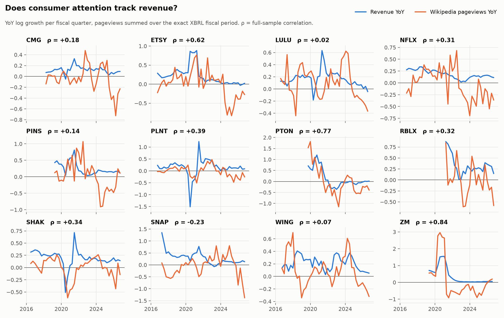
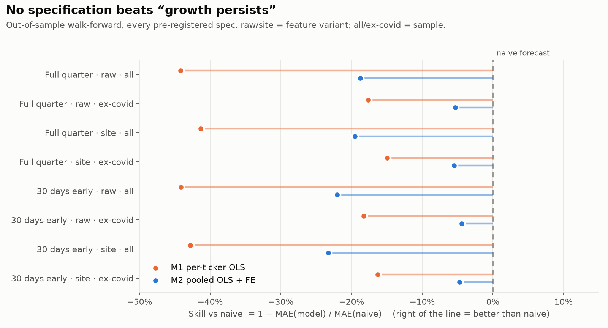
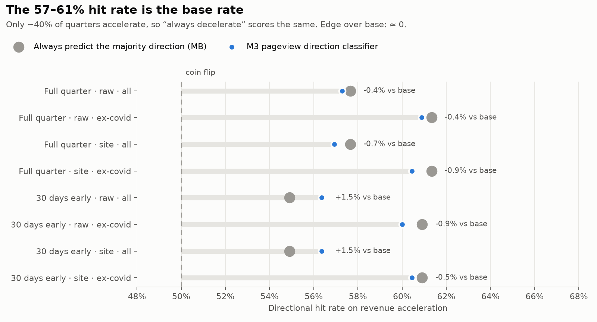
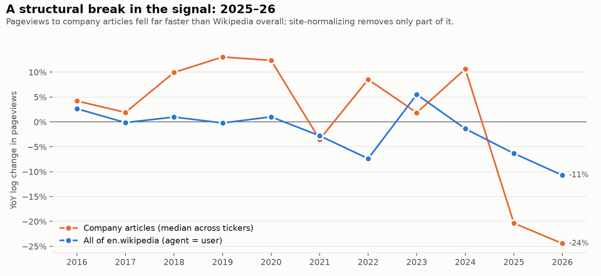
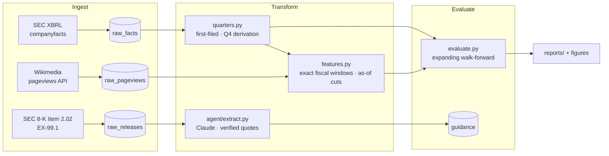

# Alt-Data KPI Nowcast

**Can free alternative data tell you, before earnings, whether a company's revenue growth will speed up or slow down?**

This repo tests that question for Wikipedia pageviews on 12 consumer and TMT companies. The pipeline is strictly point-in-time: SEC XBRL revenue is used only from the date it was filed, pageviews are aggregated over each company's exact fiscal quarter, and every model is scored out of sample in a walk-forward against a naive baseline. An LLM extractor then pulls revenue, KPIs and management guidance out of 8-K earnings releases, and its accuracy is measured against XBRL.

> **Result: no.** Out of sample, no model using pageviews beats "growth persists" (best skill −4%, none significant). The direction classifier's 57–61% hit rate turns out to equal the base rate of decelerations. The result holds across every pre-registered robustness check. It's reported as a negative result, with the reasons it fails.



---

## Key findings

| | Finding | Evidence |
|---|---|---|
| 1 | **Pageviews add nothing beyond momentum.** Per-ticker OLS and pooled fixed-effects models lose to the naive forecast in all 16 regression specs. | [skill chart](#results), `reports/results_m3.md` |
| 2 | **The directional "edge" is the base rate.** Only ~40% of quarters accelerate, so "always predict deceleration" scores ~58%. The classifier matches that, and its best edge over the base rate is +1.5%. | [hit-rate chart](#results) |
| 3 | **Correlation is not a nowcast.** Some tickers show high in-sample correlation (ZM ρ=0.84, PTON 0.77), but it comes from shared shocks like COVID. It doesn't help predict next quarter once last quarter's growth is known. | small multiples above |
| 4 | **The signal has a structural break.** Company-article pageviews fell 20–24% YoY in 2025–26, while Wikipedia overall fell 6–11%. Normalizing by site-wide traffic removes only part of the drop. | [decline chart](#results) |
| 5 | **LLM extraction is accurate and cheap.** Claude Haiku 5.5 matched XBRL revenue on 28/28 pilot releases where it found a figure. Every number is checked against a verbatim quote from the source, at about $0.0025 per release. | `reports/extraction_m4.md` |

## Results

<p align="center">
  
  
</p>

Primary spec: full-quarter cut, raw feature, all quarters, n = 281 out-of-sample ticker-quarters.

| Model | What it is | Skill vs naive | Direction hit rate | vs base rate |
|---|---|---:|---:|---:|
| M0 | Naive: `ŷ_q = y_{q−1}` | — | — | — |
| M1 | Per-ticker OLS `y ~ y_lag + x` | −44% | 54% | −4% |
| M2 | Pooled OLS, ticker fixed effects | −19% | 52% | −6% |
| M3 | Logistic `sign(Δy) ~ Δx` | — | 57% | −0.4% |
| MB | Majority direction in the training window | — | 57% | — |

Robustness checks, all pre-registered in `docs/DESIGN.md` §16:
- Site-normalized feature
- Excluding COVID (2020Q2–2021Q2)
- The 30-days-early cut
- Leaving out one ticker at a time
- Cross-sectional IC (mean 0.04–0.13; no spec has |t| > 2)

None changes the conclusion. Full tables are in [`reports/results_m3.md`](reports/results_m3.md).



## How it works



Everything lives in one DuckDB file (`data/nowcast.duckdb`). Raw HTTP responses are cached under `.cache/raw/`, so re-runs make zero network calls (`NOWCAST_OFFLINE=1` enforces this).

### Point-in-time guarantees

Each rule below is enforced in code and covered by a test.

| Rule | Implementation | Test |
|---|---|---|
| A target enters training only after its `filed` date | `walk_forward`: train on rows with `filed < asof` | `test_leakage_rule1_targets_filed_after_asof_never_used` |
| Features use only pageviews dated ≤ as-of | `features._window` | `test_leakage_views_after_asof_do_not_change_features` |
| Winsorization thresholds use only data up to the as-of date | `winsor_cap(s, asof)` | `test_winsor_cap_uses_only_past_data` |
| A lagged target is used only if already filed | prediction skipped otherwise | `test_prediction_skipped_when_lagged_target_not_yet_filed` |
| As-reported values, not restated ones | earliest-filed fact across revenue concepts; restatements logged | `test_first_filed_wins_and_restatement_logged` |
| Guidance known only from its release date | `guidance.source_filed` | `test_guidance_rows_only_verified_next_quarter_revenue` |

### Details that matter
- **Exact fiscal periods.** Pageviews are summed over each quarter's `[start, end]` from XBRL, so 52/53-week years and January fiscal year-ends (LULU, ZM) need no calendar guessing.
- **Q4 derivation.** Most filers report Q4 only inside the 10-K, so Q4 = FY − (Q1+Q2+Q3), dated to the 10-K's filing.
- **Concept switches around ASC 606.** The as-reported value is the earliest-filed fact across `RevenueFromContract…`, `Revenues` and `SalesRevenueNet`. Comparatives re-tagged a year later can't move a quarter's as-of date.
- **Wikipedia page moves.** The pageviews API counts each exact title and doesn't follow redirects. Renamed articles (Lululemon Athletica → Lululemon, the Peloton and Zoom titles) are summed across their titles, found from the move log.
- **Honest baselines.** The base-rate benchmark `MB` was added after the first run, once the binomial test against 50% proved to be the wrong null. That addition is disclosed in DESIGN.md §16, and it only makes the bar stricter.

## Universe

12 tickers, all passing the ≥24-quarter overlap criterion ([`reports/universe_check.md`](reports/universe_check.md)). Each has a CIK, a Wikipedia article and a rationale in [`config/universe.yaml`](config/universe.yaml).

`NFLX` · `CMG` · `ETSY` · `LULU` · `SHAK` · `WING` · `PLNT` · `SNAP` · `PINS` · `PTON` · `ZM` · `RBLX`

## Quickstart

```bash
git clone https://github.com/ntcode12/alt-data-kpi-nowcast && cd alt-data-kpi-nowcast
cp .env.example .env          # set CONTACT_EMAIL (SEC and Wikimedia require one); ANTHROPIC_API_KEY for extraction
uv sync

uv run nowcast ingest           # SEC facts + pageviews into DuckDB (cached)
uv run nowcast check-universe   # data check against the selection criteria
uv run nowcast build            # quarters, restatements, features
uv run nowcast evaluate         # walk-forward over every pre-registered spec
uv run nowcast charts           # README figures
uv run nowcast ingest-releases  # 8-K earnings releases
uv run nowcast extract --sample 30   # LLM extraction pilot (claude-haiku-5-5 by default)
uv run pytest                   # 94 tests, no network
```

| Command | Writes |
|---|---|
| `ingest` | `raw_facts`, `raw_pageviews`, `raw_site_pageviews` |
| `check-universe` | `reports/universe_check.md` |
| `build` | `quarters`, `restatements`, `features` |
| `evaluate` | `predictions`, `reports/results_m3.md` |
| `charts` | `reports/figures/*.png` |
| `ingest-releases` | `raw_releases` |
| `extract` | `llm_extractions`, `guidance`, `reports/extraction_m4.md` |
| `spot-check T…` | prints recent quarters with EDGAR links for checking by hand |

## Repository layout

```
config/universe.yaml          tickers, CIKs, Wikipedia titles (+ pre-move aliases), rationale
src/nowcast/
  ingest/                     sec_facts · sec_filings · wiki_pageviews · wiki_titles
  http.py                     cached, rate-limited client (SEC ≤ 10 req/s, declared User-Agent)
  quarters.py  features.py    point-in-time target and feature construction
  models.py    evaluate.py    M0–M3 + MB, walk-forward, DM / binomial / IC
  agent/extract.py            structured-output extraction with quote verification
  charts.py    cli.py
tests/                        leakage tests first; HTTP mocked; no network
reports/                      generated results, data checks, figures
docs/DESIGN.md                design and pre-registration
```

## Data and compliance

All data is public: SEC EDGAR and the Wikimedia REST API. There is no PII and no MNPI. Every client sends a descriptive User-Agent with a contact email, stays under SEC's 10 requests/second, and caches responses so nothing is fetched twice. The LLM only extracts from text it is given and is never used to forecast, since it may have seen historical outcomes in training.

## Limitations and next steps

- **LLM extraction full run.** Only the 30-release pilot has run. The full run over all ~496 releases (about $1.22 on Haiku) will fill the `guidance` table for the beat/miss-vs-guidance analysis. About 7 of 12 tickers give quarterly dollar revenue guidance; the restaurants and PLNT don't.
- **Guidance and KPI accuracy aren't measured against hand labels.** Every value is verified to quote the source, but precision and recall aren't measured.
- **Small sample.** About 23–41 usable quarters per ticker. The verdict is "no detectable signal at this sample size", not proof that none exists.
- **The pageview signal is drifting.** The 2025–26 decline suggests AI search and summaries are changing how people reach Wikipedia. Any future use of this signal needs to model that break directly.
- **Per-ticker research notes are not yet written.**
